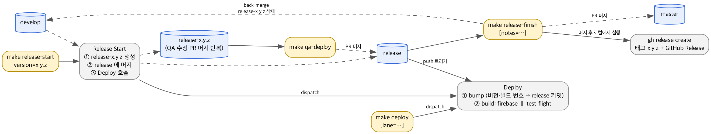

# iOS-release-pipeline-sandbox

`release`(배포 전용) + `release-x.y.z`(QA 작업) 브랜치 모델과 GitHub Actions 배포 파이프라인을 검증하는 테스트 레포.
빌드는 시뮬레이터까지만 하고 Firebase / TestFlight 업로드는 stub 이다.

## 1. 구성

| 경로 | 역할 |
|---|---|
| `Project.swift` | Tuist 4.12.1. 앱 `TestApp` + 위젯 `TestWidget` |
| `Tuist/Package.swift`, `Podfile` | SPM 4개(Alamofire·SnapKit·RxSwift·Kingfisher) + CocoaPods 1개(Toast-Swift). Deploy 의 의존성 캐시(5절) 검증용으로 Timespread 와 같은 구조 |
| `Config/Version.xcconfig` | `MARKETING_VERSION` / `CURRENT_PROJECT_VERSION`. 두 Info.plist 가 `$(…)` 로 참조. **CI 만 수정** |
| `fastlane/Fastfile` | `bump`, `firebase`(stub), `test_flight`(stub) |
| `Makefile` | 아래 명령어 표 |
| `.github/workflows/release-finish.yml` | `master` push 시 태그·GitHub Release 생성, `release-x.y.z` 삭제 (5절) |
| `scripts/ci/set-secrets.sh` | `fastlane/.env` 의 값을 GitHub Actions Secret 으로 등록 (샌드박스는 시크릿을 쓰지 않으므로 구조 검증용) |
| `fastlane/.env.example` | 시크릿 이름과 출처. 실제 값은 gitignore 된 `fastlane/.env` 에 |
| `scripts/pr-body.sh` | Makefile 이 여는 PR 의 제목·본문 생성 (5절 "PR 제목·본문") |
| `.github/workflows/release-start.yml` | 릴리스 시작 (3절) |
| `.github/workflows/deploy.yml` | 배포 (5절) |
| `.github/workflows/cache-warm.yml` | Deploy 의존성 캐시를 미리 만들고(warm) 살려 둠(keep-alive) (5절) |

## 2. 브랜치와 흐름



```
develop ─┬─ make release-start version=1.0.1
         │     ├─ release-1.0.1 생성 (develop 과 같은 커밋, 버전 커밋 없음)
         │     ├─ release 에 머지
         │     └─ Deploy 실행 → release 에 "1.0.1 (1)" 커밋 → Firebase + TestFlight
         │
         │  QA 수정: fix/* → PR → release-1.0.1
         │  빌드 필요할 때: make qa-deploy branch=release-1.0.1  → "(2)", "(3)" …
         │
         │  마지막 qa-deploy 빌드가 제출 빌드다
         └─ make release-finish thread=<slack url>
               → release → master, release → develop PR 생성
               → 리뷰 승인 → GitHub 에서 두 PR 머지
               → master push 로 Release Finish 워크플로: 태그·GitHub Release 생성, release-1.0.1 삭제
```

| 브랜치 | 역할 | 누가 커밋하나 |
|---|---|---|
| `develop` | 기능 개발 | 개발자 (PR) |
| `release-x.y.z` | 버전별 QA 작업. 수정 PR 의 base. **Version.xcconfig 를 건드리지 않는다** | 개발자 (PR) |
| `release` | 배포 전용. 여기 push 되면 Deploy 가 돈다 | **머지 커밋과 CI 의 bump 커밋만** |
| `master` | 기본 브랜치, 상용 | `release → master` PR 머지 (승인 1명) |

## 3. 명령어

레포 루트에서 실행한다. `gh auth login` 이 되어 있어야 한다. GitHub 웹의 Actions → Run workflow 로도 같은 일을 할 수 있다.

### 개발자가 쓰는 명령

| 명령 | 하는 일 |
|---|---|
| `make release-start version=x.y.z` | 릴리스 시작. 브랜치 생성 + `release` 머지 + 첫 배포 `(1)` |
| `make qa-deploy [branch=release-x.y.z]` | QA 수정분 배포. `release-x.y.z → release` PR 머지 → Deploy. branch 생략 시 현재 브랜치 |
| `make deploy [lane=both\|firebase\|test_flight]` | 코드 변경 없이 재배포. 빌드 번호만 +1 |
| `make deploy-firebase` / `make deploy-testflight` | 위의 단축 |
| `make release-finish [thread=<slack url>]` | 마감 시작. `release → master`·`release → develop` PR 두 개를 연다 (제목·본문 자동). 이후는 승인 → GitHub 에서 머지 → Release Finish 워크플로가 마무리. 재실행하면 이미 열린 PR URL 만 다시 보여준다 |
| `make runs` | 최근 실행 10개 |
| `make generate` | 로컬 Tuist 프로젝트 생성 |

### 내부·재시도용 명령

정상 흐름에서는 위 명령이 내부에서 호출한다. **문제가 발생하지 않는 한 개발자가 직접 실행하지 않는다.**

| 명령 | 하는 일 |
|---|---|
| `make open-release-pr base=master\|develop [thread=…]` | [문제가 발생하지 않는 한 개발자가 직접 실행하지 않음] `release → base` PR 을 열고 URL 만 출력. `release-finish` 가 내부에서 쓴다 |
| `make watch workflow=Deploy` | [문제가 발생하지 않는 한 개발자가 직접 실행하지 않음] 해당 워크플로의 최신 run 을 따라가며 출력. 배포 명령이 내부에서 쓴다. 터미널을 끊었다가 다시 보고 싶을 때 직접 실행 |

## 4. 릴리스 한 사이클

### 4.1 시작
```bash
make release-start version=1.0.1
```
- `release-1.0.1` 이 develop 의 현재 커밋에서 만들어진다. **버전 커밋은 없다.** 로컬에서 이 브랜치를 빌드하면 이전 버전 번호가 보이는데 정상이다.
- `release` 에 머지되고 Deploy 가 `version=1.0.1` 로 실행되어 `release` 에 `Bump version to iOS 1.0.1 (1)` 커밋이 생기고 Firebase 와 TestFlight 로 나간다.
- `make` 는 Release Start 까지만 기다린다. 이어지는 Deploy 는 `make watch workflow=Deploy` 로 본다.

### 4.2 QA 수정
```bash
git fetch origin
git checkout -b fix/some-bug origin/release-1.0.1
# 수정, 커밋
gh pr create --base release-1.0.1
```
- base 는 반드시 `release-1.0.1`. develop 이 아니다.
- `Config/Version.xcconfig` 는 건드리지 않는다 (6절).

### 4.3 QA 빌드 배포
```bash
make qa-deploy branch=release-1.0.1
```
- 수정 PR 이 몇 개 쌓였든 이 명령 한 번이 빌드 하나다. 필요할 때만 실행해 빌드 수를 조절한다.
- 빌드 번호는 `release` 에서 +1 된다. `release-1.0.1` 의 번호는 바뀌지 않는다.
- 같은 브랜치에서 연속으로 실행하면 앞선 run 은 취소된다 (최신 커밋만 빌드). 앞선 run 의 bump 가 이미 push 됐으면 그 번호는 빌드 없이 건너뛴다.

### 4.4 마감
```bash
make release-finish thread=https://linkareer.slack.com/archives/…   # thread 는 선택
```
1. `release → master`, `release → develop` PR 두 개가 열린다. 제목·본문은 자동(5절 "PR 제목·본문"). 여기까지가 로컬의 역할이다.
2. 리뷰어가 두 PR 을 승인한다. PR 작성자는 자기 PR 을 승인할 수 없으므로 다른 계정이 필요하다.
3. GitHub 에서 두 PR 을 **Merge commit** 으로 머지한다 (squash 금지). 머지 후 나오는 **Delete branch 버튼은 누르지 않는다.** head 가 영구 브랜치 `release` 라 지워진다.
4. master 머지로 `Release Finish` 워크플로가 돌아 태그 `1.0.1` + GitHub Release 를 만들고 `release-1.0.1` 을 지운다. Release 본문은 `배포일` + PR 본문의 🔧 변경 사항. 손으로 다듬고 싶으면 머지 전에 PR 본문을 고친다.

- 마지막 `qa-deploy` 빌드가 제출 빌드다. 마감 전에 별도 빌드를 만들지 않는다.
- 머지 순서는 상관없다. develop 머지는 워크플로와 무관하다.
- 워크플로가 실패하면 Actions 에서 Re-run. 같은 버전 Release 가 이미 있으면 생성은 건너뛰고 브랜치 삭제만 다시 시도한다.

### 4.5 hotfix (미구현)
master(태그)에서 `release-x.y.z` 를 분기하는 것만 다르고 나머지 흐름은 같다. 현재 `release-start` 는 develop 에서만 분기하므로, 필요해지면 워크플로에 `base` 입력(기본 develop)을 추가한다.

## 5. CI 가 하는 일

### Release Start (`release-start.yml`, ubuntu)
1. `x.y.z` 형식 검사, 같은 이름의 브랜치가 있으면 중단
2. develop 에서 `release-x.y.z` 생성
3. `release` 에 `--no-ff` 머지 후 push
4. Deploy 를 `lane=both version=x.y.z` 로 실행 (GITHUB_TOKEN push 는 워크플로를 트리거하지 않으므로 직접 dispatch)

### Deploy (`deploy.yml`)
| job | 러너 | 내용 |
|---|---|---|
| `bump` | ubuntu | `release` 가 아니면 중단. 버전 결정(아래) → `Config/Version.xcconfig` 수정 → `release` 에 push |
| `build firebase · x.y.z (n)` | macos-26 | bump 커밋 체크아웃 → Xcode 26.6 → 캐시 복원 → `tuist install` / `generate` → `pod install` → 캐시 저장 → `fastlane ios firebase` |
| `build test_flight · x.y.z (n)` | macos-26 | 위와 같고 `fastlane ios test_flight` |

버전 결정 규칙:
1. dispatch 입력 `version` 이 있으면 그 값
2. 없으면 push 이벤트 커밋 메시지에서 `release-x.y.z` 를 찾는다 (PR 머지 커밋에는 head 브랜치 이름이 들어 있다)
3. 둘 다 없으면 현재 값 유지
4. 결정된 값이 현재 `MARKETING_VERSION` 과 **다르면** `x.y.z (1)`, **같으면** 빌드 번호 +1

의존성 캐시 (`actions/cache/restore` · `save`):

| 캐시 | 경로 | 키 |
|---|---|---|
| SPM | `Tuist/.build` | `spm-<os>-` + `hashFiles(Tuist/Package.resolved, .mise.toml)` |
| Pods | `Pods` | `pods-<os>-` + `hashFiles(Podfile.lock)` |

- 두 build job 이 각각 복원한다. 히트하면 `tuist install`·`pod install` 은 네트워크 없이 끝나 중복 설치 시간이 사라진다
- 정확한 키가 없으면 `restore-keys` 로 가장 최근 캐시를 부분 복원한 뒤 설치하고, 새 키로 저장한다. 히트했으면 저장하지 않는다. 두 job 이 같은 키를 동시에 저장하려 하면 뒤쪽은 "already exists" 경고만 나고 넘어간다
- **삭제 시점**: 마지막 접근 후 7일 미사용, 또는 리포 캐시 합계가 10GB 를 넘어 오래된 것부터 밀려날 때 GitHub 가 자동 삭제한다. 릴리스 간격이 일주일을 넘으면 다음 사이클 첫 Deploy 는 캐시 없이 설치한다. 수동 삭제는 Settings → Actions → Caches 또는 `gh cache delete`
- 캐시는 생성 브랜치와 기본 브랜치에서만 보인다. Deploy 는 항상 `release` 에서 돌므로 `release` 끼리 공유된다

### Cache Warm (`cache-warm.yml`)

캐시는 생성 브랜치에서만 보이므로 `release` 범위에 미리 만들어 두어야 사이클 첫 Deploy 부터 히트한다. 두 트리거 모두 `release` 가 아닌 ref 에서 뜨기 때문에 `relay` job 이 자기 자신을 `--ref release` 로 dispatch 하고, `release` ref 의 run 이 실제 작업을 한다.

| 트리거 | relay → release 에서 하는 일 | 러너 |
|---|---|---|
| develop push 중 `Tuist/Package.resolved`·`Podfile.lock`·`.mise.toml` 변경 | **warm**: 그 커밋을 체크아웃해 `restore-keys` 부분 복원 → 설치 → 새 키로 저장 | macos-26 |
| cron 일·수 03:00 KST | **keep-alive**: 키 접두사로 최신 캐시를 복원만 한다(접근 = 수명 연장). 2주 사이클 사이의 7일 삭제를 막는다 | ubuntu |
| 수동 `gh workflow run cache-warm.yml --ref release -f mode=…` | 위 둘 중 하나 | |

- 이 파일은 **기본 브랜치(dispatch 등록)와 `release`(실행 ref) 양쪽**에 있어야 동작한다. 첫 사이클을 거치면 충족된다
- Deploy 의 Restore/Save 는 그대로 둔다. warm 이 없었거나 삭제된 경우의 안전망
- 의존성이 바뀌어도 배포는 막히지 않는다. warm 이 먼저 돌지 않았으면 Deploy 가 미스로 설치하고 저장할 뿐이다

bump 커밋은 GITHUB_TOKEN 으로 push 되므로 Deploy 가 다시 돌지 않는다. `concurrency` 로 같은 브랜치의 이전 run 은 취소된다. bump job 은 10초대에 끝나므로 취소는 대개 build job 에서 일어나고, 그때 이미 push 된 빌드 번호는 비게 된다 (단조 증가만 유지되면 문제 없음).

### Release Finish (`release-finish.yml`, ubuntu)
master 에 push 되면 master 의 `Config/Version.xcconfig` 버전을 읽는다. 같은 이름의 태그·Release 가 이미 있으면 release 머지가 아닌 push 로 보고 아무것도 만들지 않는다. 없으면 `gh release create` 로 태그 + Release(배포일 + 머지 PR 본문의 🔧 변경 사항, 못 찾으면 자동 생성)를 만들고, `release-x.y.z` 브랜치가 있으면 지운다. 재실행해도 안전하다.

### PR 제목·본문 (`scripts/pr-body.sh`)
Makefile 이 여는 PR 세 종류는 사람이 쓰지 않고 스크립트가 git/gh 에서 뽑아 채운다. 생성은 PR 을 **처음 열 때만** 하고, 고치고 싶으면 GitHub 에서 직접 수정한다 (재실행해도 덮어쓰지 않는다).

| PR | 제목 | 본문 | 리뷰 |
|---|---|---|---|
| `release-x.y.z → release` (`qa-deploy`) | `deploy: release-x.y.z (n건)` | `## 배포 내용` 아래에 `release` 에 아직 없는 변경: 머지된 PR(`#번호 제목`)과 직접 커밋 | 없음 (`release` 는 룰셋 밖) |
| `release → master` (`release-finish`) | `release: x.y.z master에 반영` | 🎯 요약(버전, 빌드 번호, `thread=` 가 있으면 관련 스레드) / 📋 작업 배경(고정 문구) / 🔧 변경 사항 = 지난 태그 이후 머지된 PR 을 제목 접두어(`feat`/`fix`/`refactor`/`update`/`chore`/기타)별로 분류 | 승인 1명 |
| `release → develop` (`release-finish`) | `release: x.y.z develop에 반영` | 위와 같고 작업 배경만 역병합 문구 | 승인 1명 |

- 변경 사항 분류는 PR 제목의 `type:` 접두어를 그대로 쓴다. 접두어가 없으면 "기타" 로 들어간다.
- `release-x.y.z → release` PR 과 bump 커밋은 변경 사항에서 제외한다 (배포 트리거일 뿐 변경이 아니다).
- 범위 기준: `qa` 는 `origin/release..origin/release-x.y.z`. `release` 는 최신 태그가 찍힌 master 머지 커밋의 두 번째 부모(= 지난 마감 시점의 `release`)부터 `origin/release` 까지 (태그가 없으면 전체). first-parent 로 걸되 배포 PR·Release Start 머지는 한 단계 안쪽까지 봐서 QA 수정 PR 과 develop 의 feature PR 을 모두 줍는다. 테스트용으로 `FROM=<ref>` 환경변수로 시작점을 바꿀 수 있다.
- 본문을 더 풍부하게 쓰고 싶으면 PR 을 연 뒤 Claude(`/create-pr` 규칙) 나 손으로 요약·배경을 보강한다. 스크립트는 사실 목록을 책임지고, 설명은 사람이 더한다.

## 6. 지켜야 할 규칙

1. **`Config/Version.xcconfig` 는 CI 만 수정한다.** 로컬에서 `fastlane ios bump` 를 돌려 push 하지 않는다. 어기면 다음 머지에서 충돌한다.
2. **머지는 전부 merge commit.** `release-x.y.z → release`, `release → master`, `release → develop` 모두. squash·rebase 금지.
3. **`release` 에 직접 push 하지 않고, 지우지 않는다.** PR 머지와 CI 커밋만 들어간다. `release → master/develop` PR 을 머지한 뒤 GitHub 가 보여 주는 Delete branch 버튼은 `release` 를 지우므로 누르지 않는다.
4. **한 번에 한 버전만.** 이전 버전이 master 로 나가기 전에 다음 `release-start` 를 하지 않는다.
5. **QA 수정 브랜치는 `origin/release-x.y.z` 에서 분기**하고 base 도 거기로.
6. back-merge 를 생략해도 충돌은 나지 않지만, develop 이 구버전 번호를 갖게 되므로 사이클마다 한다.

## 7. 검증 시나리오

1. `make release-start version=1.0.1`
   - `release-1.0.1` 브랜치가 develop 과 같은 커밋으로 생성됨 (버전 커밋 없음)
   - `release` 에 merge commit 이 push 되고, 워크플로가 Deploy 를 `version=1.0.1` 로 직접 실행
   - Deploy: `bump` 가 `Bump version to iOS 1.0.1 (1)` 을 `release` 에 push, 그 push 로 Deploy 가 다시 실행되지 않음
   - `build firebase · 1.0.1 (1)` 과 `build test_flight · 1.0.1 (1)` 이 동시에 실행되고 둘 다 `(1)` 을 빌드. run 의 Summary 에 `Deploy iOS 1.0.1 (1)` 과 bump 커밋 링크가 표시된다. `xcodebuild -version` 이 `Xcode 26.6`
2. `release-1.0.1` 에 커밋 1개 push → `make qa-deploy branch=release-1.0.1` → `(2)`
3. 커밋 2개를 push 하고 `make qa-deploy` 를 두 번 연속 실행 → 첫 run 의 `build` job 이 `cancelled`, 두 번째가 `(4)`
   - 첫 run 의 `bump` 는 10초대에 끝나 `(3)` 을 이미 push 한 뒤라 취소되지 않는다. `(3)` 은 빌드되지 않은 채 건너뛴 번호로 남는다
4. `make deploy-testflight` → `(5)`, `build test_flight · 1.0.1 (5)` 만 실행
   - `gh workflow run Deploy -R JunHyeok0206/iOS-release-pipeline-sandbox --ref develop -f lane=both` 는 `bump` 첫 step 에서 실패
5. `make release-finish thread=https://example.com/t` → `release → master`·`release → develop` PR 두 개가 열리고 종료. 제목 `release: 1.0.1 master에 반영`, 본문에 관련 스레드·변경 사항
   - 다른 계정으로 승인 → GitHub 에서 두 PR 머지 → `Release Finish` run: 태그 `1.0.1` + GitHub Release(배포일·변경 사항), `release-1.0.1` 삭제. develop 의 `Version.xcconfig` 가 `1.0.1`/`5`
   - `make release-finish` 를 다시 실행하면 "머지할 커밋 없음" 으로 끝난다
6. `make release-start version=1.0.2` → 충돌 없이 `release` 에 머지되고 Deploy 가 `1.0.2 (1)`
7. 충돌 내성 확인: `release-1.0.2` 에서 `TestApp/Resources/Info.plist` 의 아무 키나 수정해 push → `make qa-deploy` 가 충돌 없이 머지됨 (버전이 xcconfig 로 분리됐기 때문)
8. 실패 재현: `release-1.0.2` 에서 로컬로 `bundle exec fastlane ios bump` 후 push → PR 에 `Config/Version.xcconfig` 충돌 표시 (규칙 위반 케이스)
9. 캐시 확인: 의존성을 처음 넣은 Deploy 에서 두 build job 의 `Restore SPM cache` 가 "Cache not found", `Save SPM cache` 가 저장(한쪽은 already exists 경고 가능). 다음 `make deploy` 에서 `Cache restored from key: spm-…`, `Save` step 은 skipped, `Tuist install / generate`·`Pod install` 이 수 초. `Tuist/Package.swift` 의 버전을 바꿔 push 하면 `Package.resolved` 해시가 바뀌어 restore-keys 부분 복원 후 새 키로 저장
10. Cache Warm 확인 (2026-10-14 실측):
   - (a) `gh workflow run cache-warm.yml --ref release -f mode=keepalive` → keepalive job 이 `spm-macOS-…`, `pods-macOS-…` 최신 키 2개 복원 (ubuntu, 20초)
   - (b) develop 에 `lottie-spm 4.4.3` 추가 PR 머지 → push 가 relay(develop) 를 띄우고 `release` 에서 `warm @<develop sha>` 실행. 직전 캐시 부분 복원 → `tuist install` 48초(Lottie 바이너리 55MB 다운로드 4.4초 포함) → 새 키로 저장. Pods 는 히트라 skipped
   - (c) 잠금 파일이 같은 warm 은 Restore 히트 → 설치·저장 모두 skipped (약 40초)
   - 원래 (a)를 master 에서 dispatch 했을 때 relay 가 `mode` 입력을 무시하고 warm 으로 넘기는 버그가 있어 수정함
11. PR 본문 확인: 6~8 과정에서 열린 `deploy: release-1.0.2 (n건)` PR 과 `release: 1.0.2 master에 반영` / `develop에 반영` PR 의 본문이 5절 "PR 제목·본문" 대로 채워졌는지. `make release-finish … thread=<url>` 을 주면 요약에 관련 스레드가 들어간다

## 8. 자주 묻는 것

**왜 `release-1.0.1` 에는 버전 커밋이 없나?**
`release-x.y.z` 와 `release` 가 같은 줄을 서로 다르게 바꾸면 머지가 충돌한다. 버전은 `release` 한 곳에서만 바꾸도록 했다. 그래서 `release-x.y.z` 의 `Version.xcconfig` 는 항상 develop 과 같고, git 이 `release` 쪽 값을 그대로 가져간다.

**왜 버전이 별도 파일인가?**
Info.plist 안에 있으면 QA 수정이 바로 옆 줄을 고쳤을 때 충돌한다. 파일을 분리하면 그 가능성이 사라진다.

**첫 배포가 (1) 인 이유는?**
`release-start` 가 Deploy 를 `version=x.y.z` 로 실행하고, Deploy 는 버전이 바뀌면 (1) 부터 시작한다. 이후 머지마다 +1.

**TestFlight 만 다시 올리고 싶다.**
`make deploy-testflight`. 빌드 번호는 +1 되고 Firebase 는 건너뛴다.

**`develop` 에서 Deploy 를 실행하면?**
첫 step 에서 실패한다. `release` 에서만 돈다.

**Deploy 가 두 번 돌았다.**
`release` 에 사람이 직접 push 했거나 PAT 로 push 한 경우다. 규칙 3 위반.

## 9. 문제 해결

| 증상 | 원인 / 조치 |
|---|---|
| `Release Start` 가 중간에 실패 | 그대로 Re-run. 브랜치가 develop 과 같은 커밋이면 생성을 건너뛰고 머지·Deploy 호출을 이어서 한다 |
| `release-x.y.z 브랜치가 이미 있고 develop 과 다릅니다` | 그 버전의 QA 가 진행 중이거나 develop 이 바뀌었다. 재개가 목적이면 브랜치를 지우고 다시 실행, 아니면 버전을 바꾼다 |
| `Deploy` 의 build 가 실패 | **Re-run failed jobs** 를 쓴다 (bump 는 다시 돌지 않음). Re-run all jobs 를 눌러도 bump 는 이전 attempt 의 커밋을 재사용하므로 번호가 또 오르지 않는다 |
| `gh run watch` 가 run ID 를 요구 | `make watch workflow=…` 를 쓴다 (최신 run 을 찾아 준다) |
| PR 에 `Config/Version.xcconfig` 충돌 | 누군가 `release-x.y.z` 나 develop 에서 버전을 바꿨다. 해당 커밋에서 그 파일 변경만 되돌린다 |
| bump 커밋 push 가 거부됨 | `release` 에 보호 규칙(PR 필수)이 걸려 있다. 이 모델에서는 삭제·force-push 차단만 건다 |
| Actions 탭이 비어 보임 | 실행 이력이 0 개면 그렇게 보인다. `make runs` 또는 워크플로 URL 로 직접 접근 |
| Actions 목록에서 run 을 구분하기 어려움 | run 이름에 입력값이 들어간다: `Release Start 1.0.3`, `Deploy both 1.0.3`(dispatch), `Deploy push: <커밋 제목>`(push). 빌드 번호는 run 생성 뒤 bump 가 정하므로 이름에 넣을 수 없다 |
| 어떤 빌드 번호가 배포됐는지 보고 싶음 | run 상세의 job 이름(`build firebase · 1.0.3 (2)`)과 Summary(`Deploy iOS 1.0.3 (2)`)에 나온다. run 이름에는 넣을 수 없다 |
| `make release-start` 가 `No rule to make target` | 다른 디렉터리다. 레포 루트에서 실행 |
| `make qa-deploy` 가 "문서만 변경되어 Deploy 는 실행되지 않습니다" | `.md`·`docs/` 만 바뀐 push 는 `paths-ignore` 로 배포하지 않는다. 빌드가 필요하면 `make deploy` |
| `make watch` 가 "이후 생성된 run 이 없습니다" | dispatch·머지 뒤 30초 안에 run 이 생기지 않았다. Actions 탭에서 확인하고 `gh run watch <id>` |
| `Release Finish` 가 실패 | Actions 에서 Re-run. Release 가 이미 있으면 생성은 건너뛰고 브랜치 삭제만 다시 한다 |
| `Release Finish` 가 돌았는데 Release 가 없음 | master 의 `Version.xcconfig` 버전과 같은 태그가 이미 있었다. 버전이 올라가지 않은 채 머지된 경우다 |
| `release` 브랜치가 사라짐 | `release → master` PR 머지 후 Delete branch 를 눌렀다. `git push origin origin/master:refs/heads/release` 로 복구한다 (master 가 직전 release 와 같은 내용). 다음 `release-start` 는 그대로 동작 |
| `Restore … cache` 가 매번 "Cache not found" | 7일 미사용·10GB 초과로 삭제됐거나(정상, 한 번 설치하면 다시 저장) 잠금 파일이 커밋되지 않았다(`Tuist/Package.resolved`, `Podfile.lock` 은 커밋 대상) |
| `Save … cache` 가 "already exists" 경고 | 다른 build job 이 먼저 저장했다. 정상 |
| `gh pr merge` 가 "no pull requests found" (`qa-deploy`) | 같은 head 로 열린 PR 이 없다. `make qa-deploy` 를 다시 실행하면 PR 생성부터 한다 |

## 10. 로컬

```bash
mise install
bundle install
make generate          # tuist install → tuist generate → pod install
bundle exec fastlane ios bump version:1.0.0 build:0   # 동작 확인용. 결과 커밋은 push 하지 않는다 (Version.xcconfig 는 CI 만 수정)
```

## 11. 시크릿 운영

샌드박스는 시크릿 없이 돌지만, Timespread 와 같은 구조를 두어 스크립트를 검증한다.

- **누가**: 리포 admin. write 권한으로는 Secret 을 만들 수 없다.
- **언제**: 최초 1회(첫 Deploy 전), 이후 값이 바뀔 때만. 정기 만료는 없다.
- **어떻게**: `fastlane/.env` 를 `fastlane/.env.example` 대로 채운 뒤 `sh scripts/ci/set-secrets.sh`. 다른 위치의 파일을 쓰려면 `ENV_FILE=<경로> sh scripts/ci/set-secrets.sh`. 특수문자가 든 값은 작은따옴표로 감싼다. 재실행하면 덮어쓴다.
- 등록된 값은 GitHub 에서 다시 읽을 수 없으니 원본은 팀 공유 금고에 둔다.

